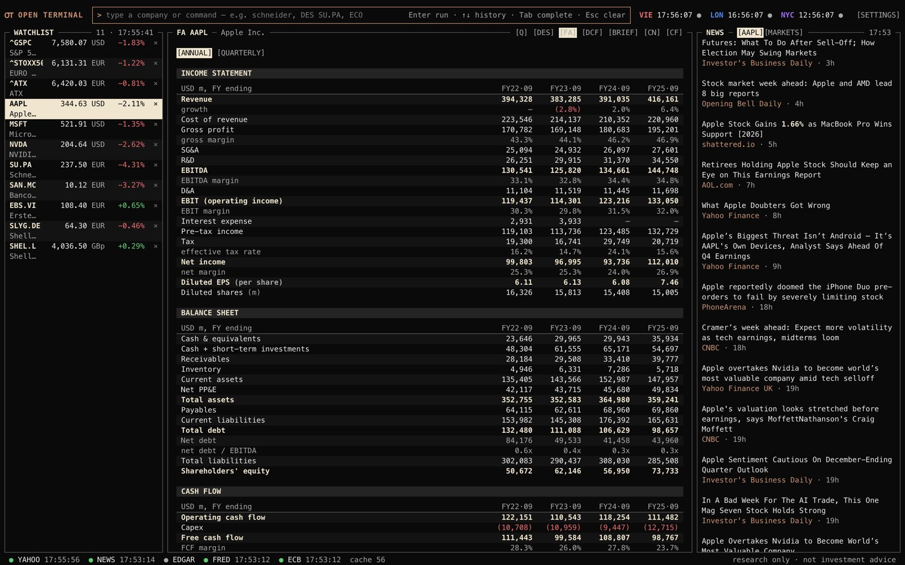
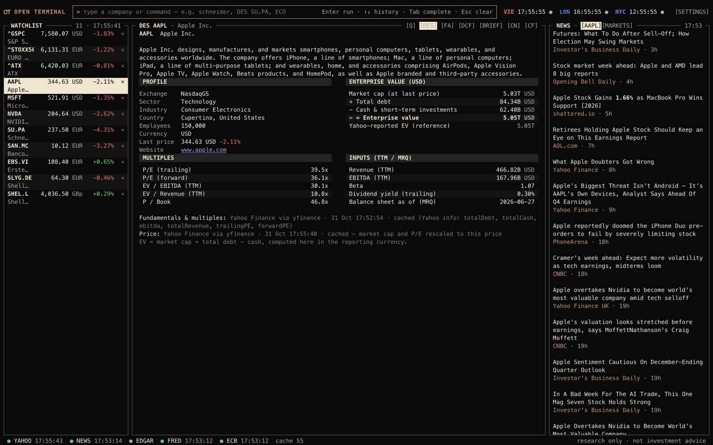
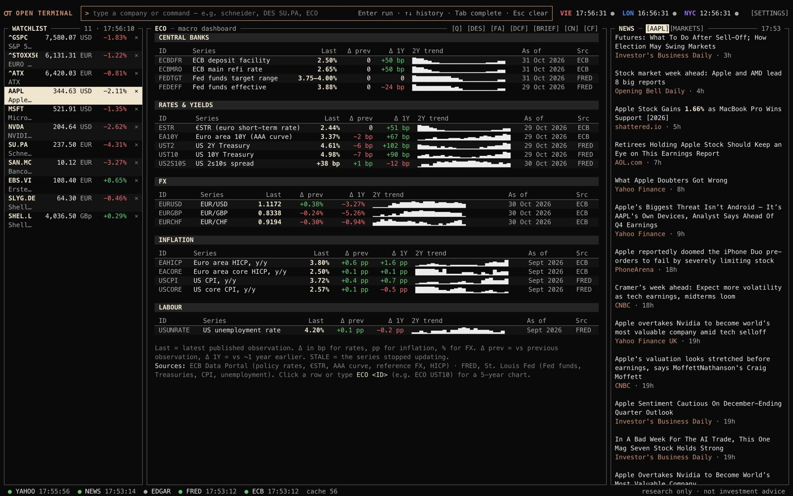

# Open Terminal

A Bloomberg-style research terminal for the Mac, built only on free public data (Yahoo Finance, SEC EDGAR, ECB, FRED and news RSS). Keyboard-first and dense on purpose: type a ticker and a mnemonic, get a tear sheet.

It's a research tool, not a trading app, and nothing in it is investment advice.

  
  

## Download

Get `MacOS.zip` from the [latest release](../../releases/latest), unzip it and move **Open Terminal.app** to Applications. It's unsigned, so right-click it and choose Open the first time.

Two optional keys unlock a couple of screens. Add them under **SETTINGS** in the app; they're stored only on your Mac.

- **SEC user agent** (your name and email, no account needed) for `CF` and the SEC cross-check in `FA`
- **FRED API key** (free) for the US tiles in `ECO`

## Commands

| Command | What it does |
|---|---|
| `Q <TICKER> [1D\|1M\|1Y\|5Y]` | Quote + price chart. Typing just a ticker does the same. |
| `1D` / `1M` / `1Y` / `5Y` | Switch the range of the chart on screen |
| `DES <TICKER>` | Description, profile, **EV bridge**, P/E, EV/EBITDA, EV/Revenue, P/B |
| `W add <T1> <T2>…` / `W remove <T>` | Edit the watchlist (also `W rm`, or click × on a row) |
| `N <query>` | News search (Google News). Operators work: `"exact phrase"`, `site:ft.com`, `when:1d`, `OR` |
| `N` | Market headlines (FT, Reuters, WSJ, CNBC, MarketWatch) |
| `CN <TICKER>` | Company news, searched by company name |
| `FA <TICKER>` | Income statement, balance sheet, cash flow — last 4 fiscal years, with margins, growth, net debt, FCF. US and SEC-registered foreign companies get an **SEC XBRL check** |
| `FA <TICKER> Q` | Last 5 quarters + TTM (P&L and cash flow summed over 4 quarters, balance sheet latest); growth y/y vs the same quarter. Half-yearly reporters (many EU companies) get a clear message |
| `DCF <TICKER> [g= margin= tax= wacc= tg= erp=]` | 5-year unlevered FCF DCF with Gordon-growth terminal value, CAPM WACC, equity bridge, WACC × g sensitivity. Defaults come from the company's own history; edit any assumption in place and press Enter |
| `COMP <T1> <T2> … [CCY]` | Comps table: mkt cap, EV, revenue, EBITDA, margin, EV/Rev, EV/EBITDA, P/E, fwd P/E + median/mean/high/low. Optional display currency at the end (`… USD`) |
| `ECO` | Macro dashboard: ECB deposit & refi rate, Fed funds target & effective, €STR, euro 10Y (AAA), US 2Y/10Y, 2s10s, EUR/USD, EUR/GBP, EUR/CHF, euro-area HICP & core, US CPI & core, US unemployment — each with change vs previous and vs 1 year, sparkline and date |
| `ECO <ID>` | 5-year chart of one series, e.g. `ECO UST10`, `ECO EAHICP`, `ECO EURUSD` (click any tile) |
| `BRIEF <TICKER> [PEERS…]` | Research brief built only from the terminal's data: Summary (3 bullets) → Key facts (every number with a numbered source) → What it means (rule-based signals) → Risks / what's uncertain → Sources (links + timestamps). Add peers for a premium/discount vs the peer median, e.g. `BRIEF SU.PA SIE.DE ABBN.SW ETN` |
| `REP` / `REP <#>` | Saved briefs: list, reopen, export to Markdown, delete |
| `CF <TICKER>` | SEC filings (10-K, 10-Q, 20-F, 6-K, 8-K, proxies) with links; filter by ANNUAL / QUARTERLY / EVENTS / PROXY |
| `HELP` | All commands and shortcuts |

Bloomberg order works too: `SU.PA DES`, `AAPL Q 5Y`, `SAN.MC CN`, `SHEL.L FA`.

Bloomberg order works too (`AAPL DES`, `SHEL.L FA`). Tickers use Yahoo symbols with exchange suffixes, e.g. `SU.PA`, `SHEL.L`, `^GSPC`, `EURUSD=X`.

## How the numbers work

- Every figure shows its source and when it was fetched. Cached values are marked, and anything from a source that's down is flagged as stale.
- EV is computed in the terminal (market cap + debt − cash), with currency handled properly when a company trades and reports in different currencies.
- `FA` checks revenue, net income, EPS, operating cash flow and total assets against the company's SEC XBRL filings where available.
- `BRIEF` is rule-based, not AI. Every number in it links back to a numbered source.
- Yahoo prices can be delayed 15–20 minutes depending on the exchange.

## License

Free for personal and other non-commercial use under PolyForm Noncommercial 1.0.0. See [LICENSE](LICENSE).
